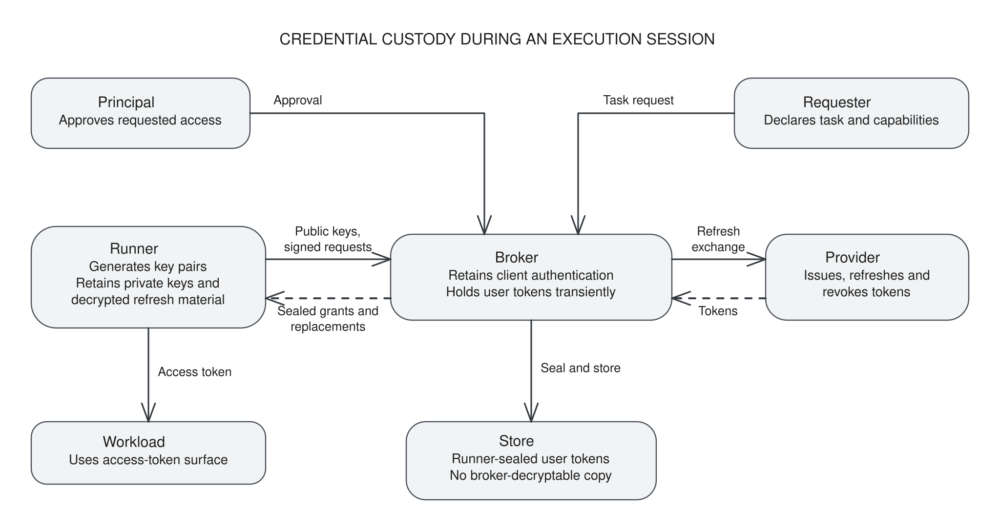
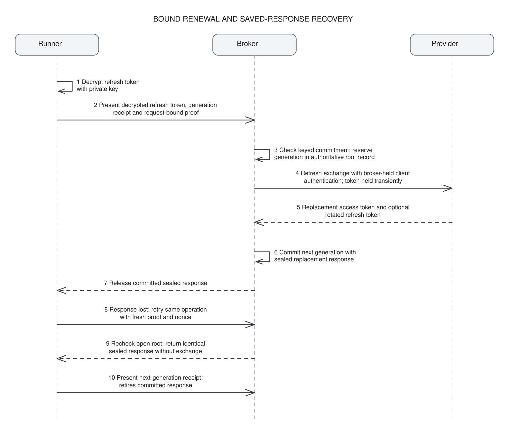
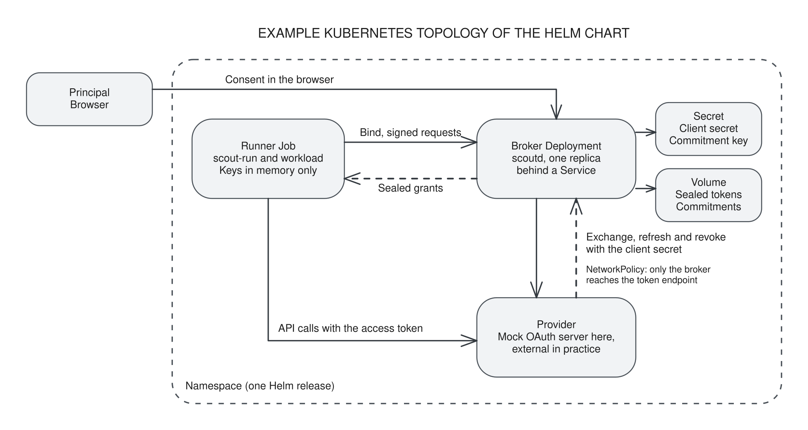

# SCOUT

**Split-custody, session-bound credential renewal for human-authorized AI agents.**

[](https://doi.org/10.5281/zenodo.24568572) [](https://github.com/Algiras/scout-proofs/actions/workflows/verify.yml)

An agent that works on a person's behalf needs that person's access to third-party APIs, often for longer than one access token lives. Something has to hold the refresh token and, for confidential OAuth clients, the client secret. SCOUT splits the two: the ephemeral **runner** holds the refresh token and the only key that opens stored tokens, and the **broker** holds the client secret. A copy of the broker's storage contains no token it can decrypt, and a runner alone cannot refresh.

This repository contains the paper, a reference implementation in Rust with a Helm chart, and machine-checked proofs of the protocol in five tools.



## What is here

| Path | Contents |
|---|---|
| [`paper/`](paper/) | The paper (PDF and LaTeX source) |
| [`impl/`](impl/) | Reference implementation in Rust: broker, runner CLI, mock OAuth provider, tests, Dockerfile, Docker Compose demo |
| [`deploy/helm/scout/`](deploy/helm/scout/) | Helm chart with an example Job |
| [`proofs/`](proofs/) | Formal models and proofs: Z3, Lean 4, TLA+, ProVerif |
| [`docs/img/`](docs/img/) | Diagrams (SVG, and the editable Excalidraw source of the topology) |

## How renewal works

Providers that rotate refresh tokens invalidate the presented token when it is used. If the reply carrying the replacement is lost, the credential is gone. SCOUT reserves a renewal generation for one operation, calls the provider once, and stores the runner-sealed reply together with the next commitment in a single conditional write. A retry gets the identical ciphertext without a second provider call, although the broker cannot read what it replays. A keyed commitment, checked before the client secret is used, stops the broker from refreshing a token that was issued under someone else's approval.



## Try it

With Docker:

```sh
cd impl
docker compose up --build --abort-on-container-exit --exit-code-from runner
```

This starts a mock OAuth provider, the broker and a runner. The runner completes a session, runs a small workload that calls the provider's API, renews its access token several times, then revokes and finalizes.

Without Docker, see the three commands in [`impl/README.md`](impl/README.md).

## Deploy the example on Kubernetes

```sh
docker build -t scout:dev impl
kind create cluster --name scout-demo
kind load docker-image scout:dev --name scout-demo
helm install demo deploy/helm/scout
kubectl wait --for=condition=complete job/demo-scout-example --timeout=180s
kubectl logs job/demo-scout-example
```



The chart runs one broker replica with a small volume for its store, a mock provider, an example runner Job, and a NetworkPolicy that lets only the broker reach the provider's token endpoint. The secrets it generates are for the demo; use an existing Secret for anything else.

## What is proved, and by what

Every property is paired with a deliberately broken variant that the tool must reject.

| Tool | What it checks | Scope |
|---|---|---|
| Z3 | 41 inductive-invariant obligations over six models (session, delivery, renewal, assertion-mediated renewal, teardown, authorization epoch); 26 broken variants | Unbounded generations, retries and crashes |
| Lean 4 | The same obligations as 63 theorems accepted by the Lean kernel | Unbounded |
| TLA+ / TLC | The same six models and their 26 broken variants | Exhaustive within finite bounds |
| ProVerif | Token secrecy, lineage binding, revocation scope, broker compromise, assertion-mediated renewal, supervised delegation: 17 scenarios | Active network attacker, unbounded sessions |
| Kani | The Rust protocol core itself: 14 proof harnesses for the session, delivery, renewal and teardown properties; 4 broken variants | The real code in `impl/scout-core`, any number of steps |

The Rust tests add an exhaustive search of the real renewal code against the model, and end-to-end tests for lost replies, competing operations, ambiguous provider outcomes, foreign tokens, storage snapshots and closure.

These are proofs about models and about the protocol core. They do not cover the HTTP and storage shell around the core, the cryptographic primitives, or a provider's behaviour. The paper states the assumptions and limits in full.

Run everything:

```sh
python3 proofs/scout_smt.py
python3 proofs/export.py --check-lean --check-tla /path/to/tla2tools.jar
python3 proofs/symbolic/gen.py && python3 proofs/symbolic/gen_assertion.py && python3 proofs/symbolic/gen_delegation.py
cd impl && cargo test --workspace && cd scout-core && cargo kani
```

The same checks run in CI on every push.

## Status and limits

This is a reference implementation, not a production service: one broker replica with a file-backed store, no TLS in the server itself, and a mock provider. Assertion-mediated renewal and the delegation supervisor are specified and proved in the models but not implemented. See [`impl/README.md`](impl/README.md).

## Help wanted: arXiv endorsement

The paper is published on Zenodo. To post it on arXiv in cs.CR as well, I need an endorsement from an existing arXiv author in computer science. If you can endorse, or know someone who might, please see [this issue](https://github.com/Algiras/scout-proofs/issues/1).

## How to cite

If you use this work, cite the paper:

> Algimantas Krasauskas. *SCOUT: Split-Custody, Session-Bound Credential Renewal for Human-Authorized AI Agents*. November 2026. Zenodo. https://doi.org/10.5281/zenodo.24568572

GitHub's "Cite this repository" button gives the same reference in BibTeX and APA form. That DOI always resolves to the latest version; the first published version is https://doi.org/10.5281/zenodo.24568573.

## Licence

[Creative Commons Attribution 4.0 International](https://creativecommons.org/licenses/by/4.0/) (CC BY 4.0); see [`LICENSE`](LICENSE). You may use, share and adapt this work for any purpose, provided you cite the paper.
